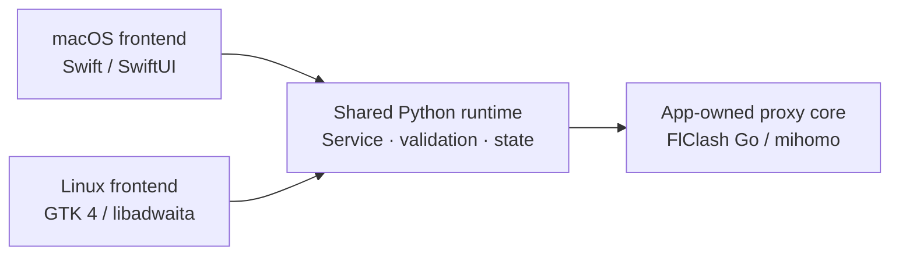

**English** | [简体中文](README.zh-CN.md)

# ZFly

ZFly is a native desktop engineering project for macOS and Linux, implemented as a standalone proxy client. The two frontends use their platform's native UI toolkit, while a shared Python runtime handles validation, persistent state, and the app-owned proxy core lifecycle. FlClash does not need to be installed or running.


## Native Engineering Highlights



- **Native macOS integration:** SwiftUI system materials, a live traffic dashboard, menu-bar controls, login items, themes, and Dock / menu-bar window behavior.
- **Native Linux integration:** adaptive narrow-window navigation, StatusNotifierItem tray support, XDG autostart, GNOME proxy integration, and desktop entries / icons.
- **Shared runtime design:** a private authenticated local service, app-owned core lifecycle, atomic persistence, stale-write rejection, configuration rollback, and system proxy ownership tracking.
- **Reproducible preview and delivery:** isolated safe-mode demos, Nix packaging, DMG / DEB / RPM builds, and platform-specific CI and validation.

## Download and Install

**[Download the latest release](https://github.com/groundgrounder/ZFly/releases/latest)**. SHA-256 checksums are published as `SHA256SUMS.txt`.

| Platform | Supported architecture | Package |
| --- | --- | --- |
| macOS | Apple Silicon (arm64) only | DMG |
| Debian / Ubuntu, Fedora / RHEL | x86_64 only | DEB / RPM |
| Nix / NixOS | `x86_64-linux`, `aarch64-linux` | Flake |

### macOS

1. Download `ZFly-0.2.0-macos-arm64.dmg` from [v0.2.0](https://github.com/groundgrounder/ZFly/releases/tag/v0.2.0), or the corresponding DMG from a newer release.
2. Open the DMG and drag **ZFly.app** to **Applications**.
3. Launch ZFly from Applications.

There is no Intel build. The minimum deployment target is macOS 14, but compatibility with older macOS versions still needs physical-device validation. Current CI builds are not Developer ID signed or notarized.

### Debian / Ubuntu and Fedora / RHEL

Download the package for your distribution, then install it from your download directory:

```sh
# Debian / Ubuntu
sudo apt install ./zfly_0.2.0-1_amd64.deb

# Fedora / RHEL
sudo dnf install ./zfly-0.2.0-1.x86_64.rpm
```

Start ZFly from the application launcher or run `zfly`. These packages currently support x86_64 only.

### Nix / NixOS

With Nix flakes enabled and GitHub SSH access configured, try ZFly without installing it or install it into your user profile:

```sh
# Run directly
nix run git+ssh://git@github.com/groundgrounder/ZFly.git

# Install for the current user
nix profile install git+ssh://git@github.com/groundgrounder/ZFly.git
zfly
```

For a declarative NixOS installation, add ZFly to your flake inputs:

```nix
{
  inputs.zfly.url = "git+ssh://git@github.com/groundgrounder/ZFly.git";
}
```

Pass `inputs` to the NixOS modules with `specialArgs = { inherit inputs; };`, then add the package:

```nix
{ inputs, pkgs, ... }:

{
  environment.systemPackages = [
    inputs.zfly.packages.${pkgs.stdenv.hostPlatform.system}.default
  ];
}
```

Apply the configuration with `sudo nixos-rebuild switch --flake .#myHost`, replacing `myHost` with your configuration name. The flake provides GTK, Python, mihomo, desktop entries, and icons. The aarch64 Linux build has not completed the current round of platform validation.

## Quick Start

1. Open **Subscriptions** on macOS or **Profiles & Subscriptions** on Linux. Add a Clash / mihomo YAML subscription URL, import a local YAML file, or create a custom configuration. Plain web pages and arbitrary node-link formats are not supported as subscriptions.
2. Select a configuration and click **Start Proxy**. ZFly starts its own private local service and core automatically.
3. Choose **Rule**, **Global**, or **Direct** mode. On the proxy page, select nodes, pin nodes for automatic groups, and run latency tests.
4. Enable **System Proxy** so applications that follow system proxy settings use ZFly. Alternatively, configure an application manually with the default mixed proxy address `127.0.0.1:7890`.
5. To stop completely, quit ZFly from the app or tray menu. It stops its core and restores only system proxy settings that it still owns. On Linux, closing the window may only hide it when a tray is available.

GNOME system proxy settings are managed through gsettings. On other Linux desktops, use the desktop's supported proxy integration or configure applications manually. See the [usage guide](docs/usage.md) for subscription User-Agent settings, autostart, backups, data locations, recovery, and platform-specific behavior.

### Safe Demo Mode

Safe mode uses example data and a simulated core; it does not start a real proxy, access external networks, or change system proxy settings.

```sh
# Linux package or Nix profile
zfly --safe-mode

# macOS, after copying ZFly.app to Applications
/Applications/ZFly.app/Contents/MacOS/ZFly --safe-mode
```

The macOS demo uses an isolated temporary data directory and deletes it on exit. Demo results do not validate real proxy protocols, networking, DNS, WebDAV, or system integration.

## Application Scope and Limits

- Profile and subscription management, local YAML editing and export, custom nodes and proxy groups, scheduled updates, and usage information.
- Rule / Global / Direct modes, Selector selection, automatic-group pinning, latency tests, and connection management.
- Core, DNS / hosts, rule and resource settings; network diagnostics; local JSON and HTTPS WebDAV backup and restore. Backups contain subscriptions and credentials and are not encrypted.
- Chinese and English interfaces on both platforms; some runtime messages may still contain Chinese.

The macOS TUN privilege helper, system DNS takeover, JavaScript scripting, global hotkeys, Wi-Fi policies, QR codes, and in-app self-updates are not implemented. Linux TUN requires additional core privileges; real network interception and system proxy restoration still require platform validation. See the [validation record](docs/audit-validation-2026-10-21.md) for covered platforms and remaining gaps.

## Development

Run development commands from the root of the source checkout.

### macOS Build

Build on an Apple Silicon Mac with Swift 6 and the macOS 26 or newer SDK:

```sh
sh macos/build-app.sh
build/macos/ZFly.app/Contents/MacOS/ZFly --safe-mode
```

The output is `build/macos/ZFly.app`. It uses a local ad hoc signature; formal releases still require developer signing and notarization.

When developing the demo UI directly through SwiftPM, explicitly specify the Python and shared runtime directories. These variables are read only in `--safe-mode`:

```sh
cd macos
ZFLY_DEV_PYTHON=/absolute/path/to/python3 \
ZFLY_DEV_RUNTIME=/absolute/path/to/zfly/runtime \
swift run ZFly --safe-mode
```

<details>
<summary>macOS packaged-runtime requirements</summary>

Packaging requires a relocatable CPython 3.12, a standalone core, four non-empty Geo data files, and both core licenses:

```sh
ZFLY_PYTHON_HOME=/path/to/python-build-standalone \
ZFLY_CORE=/path/to/ZFlyCore \
ZFLY_CORE_KIND=ipc \
ZFLY_GEODATA=/path/to/geodata \
ZFLY_CORE_LICENSE=/path/to/FlClash-LICENSE \
ZFLY_MIHOMO_LICENSE=/path/to/mihomo-LICENSE \
sh macos/build-app.sh
```

Python can be placed in `build/dependencies/python`; the script also searches for CPython 3.12 installed by the local uv. The core defaults to `build/dependencies/ZFlyCore` or `build/dependencies/mihomo`; specify `ZFLY_CORE_KIND=mihomo` for standard mihomo. The build does not read a core from an installed app.

Geo data is searched in `FlClash/assets/data`, then `build/flclash-host/assets/data`, and must include `ASN.mmdb`, `GEOIP.dat`, `GEOIP.metadb`, and `GEOSITE.dat`. Licenses are read from `LICENSE` and `core/Clash.Meta/LICENSE` under those source roots, respectively. Environment variables can override these paths; the build fails if resources are missing. At the end, the build validates executables, metadata, icons, previews, localization, Geo data, licenses, and the core checksum.

The demo passes operations through the real Service's validation, transactions, rollback, and temporary persistence. Its mock core validates only YAML / schema and cannot validate real protocol semantics. See [demo mode differences](docs/usage.md#演示模式).

</details>

### Linux Build and Source Runs

```sh
nix build .#
nix flake check
nix run .# -- --safe-mode
```

With GTK 4, libadwaita, and PyGObject installed, you can also run from source. Normal operation requires a standalone core:

```sh
PYTHONPATH=linux:runtime python3 -m zfly --safe-mode
PYTHONPATH=linux:runtime ZFLY_CORE=/path/to/mihomo ZFLY_CORE_KIND=mihomo python3 -m zfly
```

### Continuous Integration

The [GitHub Actions build workflow](.github/workflows/build.yml) builds the Nix package, runs offline, GTK, and tray tests, builds and installs DEB/RPM packages, and uploads them with SHA-256 checksums for 14 days. A separate macOS job builds and tests the app, bundled core, and DMG on macOS 26, verifies the packaged preview and runtime, and uploads the DMG for 14 days. CI does not perform formal signing or notarization.

### Validation

```sh
PYTHONDONTWRITEBYTECODE=1 PYTHONPATH=runtime python3 -m unittest discover -s runtime/tests -v
PYTHONDONTWRITEBYTECODE=1 PYTHONPATH=linux:runtime python3 -m unittest discover -s linux/tests -v
swift build --package-path macos
swift test --package-path macos
sh macos/build-app.sh
python3 tools/verify-preview.py --app build/macos/ZFly.app
python3 tools/verify-runtime.py --app build/macos/ZFly.app
```

The integration scripts use only temporary data and loopback ports, and record and clean up their own runtime and core. They do not enable the system proxy, TUN, or external downloads. See the [usage guide](docs/usage.md#开发验证) for GTK graphical interaction validation.

## Source and Licensing

`macos/` contains the SwiftUI app, `linux/zfly/` contains the GTK app, and `runtime/zfly_runtime/` contains the shared standalone runtime. The sole source of preview data for both frontends is `runtime/zfly_runtime/preview.json`. `assets/icon.svg` is the editable icon source, rendered with `python3 tools/render-icons.py`.

`FlClash/` is an optional external upstream checkout and is not present in the current workspace; if present, its history and worktree must be preserved. `build/flclash-host/` is a read-only source snapshot. Legacy management bridge patches, benchmarks, and migration scripts are in [integrations/flclash](integrations/flclash/README.md) and are not used by the current app.

ZFly builds on work related to FlClash / mihomo and is licensed under [GPL-3.0](LICENSE), retaining the original copyright and license notices. Third-party Python / PyYAML and core licenses are distributed with the macOS app.
