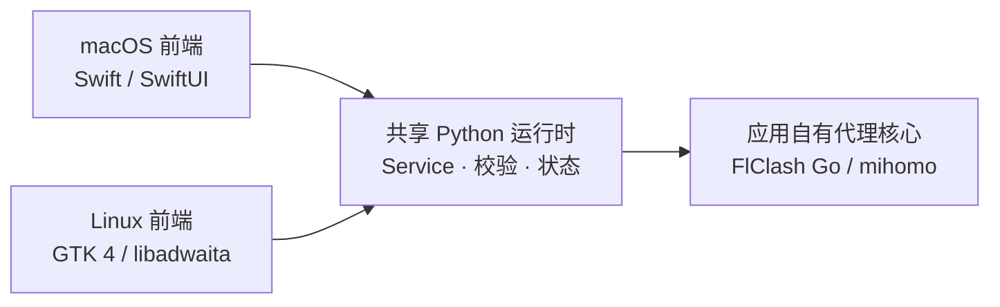

[English](README.md) | **简体中文**

# ZFly

ZFly 是一个面向 macOS 和 Linux 的原生桌面工程作品，以独立代理客户端作为完整应用场景。两个前端分别使用各平台的原生 UI 技术栈，共享 Python 运行时负责校验、持久化状态和代理核心生命周期；不需要安装或运行 FlClash。


## 原生工程亮点



- **macOS 原生集成**：SwiftUI 系统材质、实时流量仪表盘、菜单栏控制、登录项、主题，以及 Dock / 菜单栏窗口行为。
- **Linux 原生集成**：窄窗自适应导航、StatusNotifierItem 托盘、XDG 自动启动、GNOME 代理集成，以及桌面入口和图标。
- **共享运行时设计**：私有鉴权本地服务、应用自有核心生命周期、原子持久化、过期写入拒绝、配置回滚，以及系统代理所有权跟踪。
- **可复现演示与交付**：隔离安全模式、Nix 打包、DMG / DEB / RPM 构建，以及分平台 CI 和验证。

## 下载与安装

**[下载最新版本](https://github.com/groundgrounder/ZFly/releases/latest)**。Release 同时提供 `SHA256SUMS.txt` 校验文件。

| 平台 | 支持的架构 | 软件包 |
| --- | --- | --- |
| macOS | 仅 Apple Silicon（arm64） | DMG |
| Debian / Ubuntu、Fedora / RHEL | 仅 x86_64 | DEB / RPM |
| Nix / NixOS | `x86_64-linux`、`aarch64-linux` | Flake |

### macOS

1. 从 [v0.2.0](https://github.com/groundgrounder/ZFly/releases/tag/v0.2.0) 下载 `ZFly-0.2.0-macos-arm64.dmg`，或从更新版本的 Release 下载对应 DMG。
2. 打开 DMG，将 **ZFly.app** 拖入“应用程序”。
3. 从“应用程序”启动 ZFly。

不提供 Intel 版本。最低部署目标为 macOS 14，但旧版 macOS 的兼容性仍需实机验证。当前 CI 构建未经 Developer ID 签名和公证。

### Debian / Ubuntu 与 Fedora / RHEL

下载对应发行版的软件包，然后在下载目录执行：

```sh
# Debian / Ubuntu
sudo apt install ./zfly_0.2.0-1_amd64.deb

# Fedora / RHEL
sudo dnf install ./zfly-0.2.0-1.x86_64.rpm
```

安装后可从应用启动器打开 ZFly，或运行 `zfly`。这些软件包目前仅支持 x86_64。

### Nix / NixOS

启用 Nix flakes 并配置 GitHub SSH 访问后，可以直接试用，也可以安装到当前用户的 profile：

```sh
# 直接运行
nix run git+ssh://git@github.com/groundgrounder/ZFly.git

# 为当前用户安装
nix profile install git+ssh://git@github.com/groundgrounder/ZFly.git
zfly
```

如需通过 NixOS 声明式安装，先将 ZFly 添加到 flake inputs：

```nix
{
  inputs.zfly.url = "git+ssh://git@github.com/groundgrounder/ZFly.git";
}
```

通过 `specialArgs = { inherit inputs; };` 将 `inputs` 传给 NixOS 模块，然后添加软件包：

```nix
{ inputs, pkgs, ... }:

{
  environment.systemPackages = [
    inputs.zfly.packages.${pkgs.stdenv.hostPlatform.system}.default
  ];
}
```

执行 `sudo nixos-rebuild switch --flake .#myHost` 应用配置，并将 `myHost` 替换为你的配置名。flake 已包含 GTK、Python、mihomo、桌面入口和图标。aarch64 Linux 构建尚未完成本轮平台验证。

## 快速上手

1. 打开 macOS 的“订阅”或 Linux 的“配置与订阅”，添加 Clash / mihomo YAML 订阅链接、导入本地 YAML，或创建自定义配置。不支持把普通网页或任意格式的节点链接直接当作订阅。
2. 选择配置并点击“启动代理”。ZFly 会自动启动自己的私有本地服务和核心。
3. 选择“规则”“全局”或“直连”模式。在代理页选择节点、固定自动组节点，或进行延迟测试。
4. 按需开启“系统代理”，让遵循系统代理设置的应用使用 ZFly。也可以为单个应用手动填写默认混合代理地址 `127.0.0.1:7890`。
5. 需要完全停止时，从应用或托盘菜单退出 ZFly。应用会停止自己的核心，并且只恢复仍由自己持有的系统代理设置。Linux 在托盘可用时，关闭窗口可能只是隐藏窗口。

GNOME 的系统代理由 gsettings 管理；其他 Linux 桌面可使用其支持的代理集成，或手动配置应用。订阅 User-Agent、自动启动、备份、数据位置、恢复和各平台行为详见[使用说明](docs/usage.md)。

### 安全演示模式

安全模式使用示例数据和模拟核心，不启动真实代理、不访问外部网络，也不修改系统代理设置。

```sh
# Linux 软件包或 Nix profile
zfly --safe-mode

# macOS，将 ZFly.app 复制到“应用程序”后
/Applications/ZFly.app/Contents/MacOS/ZFly --safe-mode
```

macOS 演示使用隔离的临时数据目录，并在退出时删除。演示结果不能用于验证真实代理协议、网络、DNS、WebDAV 或系统集成功能。

## 应用功能与限制

- 配置与订阅管理、本地 YAML 编辑和导出、自定义节点与代理组、定时更新及用量信息。
- 规则 / 全局 / 直连模式、Selector 节点选择、自动组固定、延迟测试和连接管理。
- 核心、DNS / hosts、规则与资源设置；网络诊断；本地 JSON 与 HTTPS WebDAV 备份恢复。备份包含订阅和凭据，且未加密。
- macOS 与 GTK 均支持中文和 English，部分运行时消息仍可能包含中文。

macOS TUN 权限助手、系统 DNS 接管、JavaScript 脚本、全局热键、Wi-Fi 策略、二维码和应用自更新尚未实现。Linux TUN 需要额外核心权限，真实网络接管与系统代理恢复仍需平台验证。已覆盖平台和剩余缺口见[验证记录](docs/audit-validation-2026-10-21.md)。

## 开发

以下开发命令均在源码根目录执行。

### macOS 构建

在 Apple Silicon Mac 上构建，需要 Swift 6 和 macOS 26 或更新 SDK：

```sh
sh macos/build-app.sh
build/macos/ZFly.app/Contents/MacOS/ZFly --safe-mode
```

输出为 `build/macos/ZFly.app`。包使用本机临时签名，正式发布仍需开发者签名与公证。

直接从 SwiftPM 开发演示界面时，必须显式指定 Python 和共享运行时目录；这两个变量只在 `--safe-mode` 下读取：

```sh
cd macos
ZFLY_DEV_PYTHON=/absolute/path/to/python3 \
ZFLY_DEV_RUNTIME=/absolute/path/to/zfly/runtime \
swift run ZFly --safe-mode
```

<details>
<summary>macOS 完整包运行时要求</summary>

打包需要可重定位的 CPython 3.12、独立核心、四个非空 Geo 数据文件和两份核心许可证：

```sh
ZFLY_PYTHON_HOME=/path/to/python-build-standalone \
ZFLY_CORE=/path/to/ZFlyCore \
ZFLY_CORE_KIND=ipc \
ZFLY_GEODATA=/path/to/geodata \
ZFLY_CORE_LICENSE=/path/to/FlClash-LICENSE \
ZFLY_MIHOMO_LICENSE=/path/to/mihomo-LICENSE \
sh macos/build-app.sh
```

Python 可放在 `build/dependencies/python`，脚本也会查找本机 uv 安装的 CPython 3.12。核心默认查找 `build/dependencies/ZFlyCore` 或 `build/dependencies/mihomo`；标准 mihomo 需指定 `ZFLY_CORE_KIND=mihomo`。构建不会从已安装应用读取核心。

Geo 默认依次查找 `FlClash/assets/data`、`build/flclash-host/assets/data`，需包含 `ASN.mmdb`、`GEOIP.dat`、`GEOIP.metadb` 和 `GEOSITE.dat`。许可证分别查找上述源码根目录的 `LICENSE` 和 `core/Clash.Meta/LICENSE`。环境变量可覆盖这些路径；资源缺失时构建失败。构建结束会校验可执行文件、元数据、图标、预览、本地化、Geo、许可证与核心校验和。

演示操作经过真实 Service 的校验、事务、回滚与临时持久化。模拟核心只做 YAML / schema 校验，不能验证真实协议语义。详见[演示模式差异](docs/usage.md#演示模式)。

</details>

### Linux 构建与源码运行

```sh
nix build .#
nix flake check
nix run .# -- --safe-mode
```

安装 GTK 4、libadwaita 和 PyGObject 后也可从源码运行。正常运行需要独立核心：

```sh
PYTHONPATH=linux:runtime python3 -m zfly --safe-mode
PYTHONPATH=linux:runtime ZFLY_CORE=/path/to/mihomo ZFLY_CORE_KIND=mihomo python3 -m zfly
```

### 持续集成

[GitHub Actions 构建工作流](.github/workflows/build.yml)会构建 Nix 包，运行离线、GTK 和托盘测试，构建并安装 DEB/RPM 包，并将包和 SHA-256 校验和保留 14 天。独立的 macOS 任务在 macOS 26 上构建和测试应用、内置核心与 DMG，验证包内预览和运行时，并将 DMG 保留 14 天。CI 不执行正式签名和公证。

### 验证

```sh
PYTHONDONTWRITEBYTECODE=1 PYTHONPATH=runtime python3 -m unittest discover -s runtime/tests -v
PYTHONDONTWRITEBYTECODE=1 PYTHONPATH=linux:runtime python3 -m unittest discover -s linux/tests -v
swift build --package-path macos
swift test --package-path macos
sh macos/build-app.sh
python3 tools/verify-preview.py --app build/macos/ZFly.app
python3 tools/verify-runtime.py --app build/macos/ZFly.app
```

集成脚本仅使用临时数据和回环端口，记录并清理自己的运行时与核心；不启用系统代理、TUN 或外部下载。GTK 图形交互验证方法见[使用说明](docs/usage.md#开发验证)。

## 源码与许可

`macos/` 为 SwiftUI 应用，`linux/zfly/` 为 GTK 应用，`runtime/zfly_runtime/` 为共享独立运行时。两端预览数据的唯一来源为 `runtime/zfly_runtime/preview.json`。`assets/icon.svg` 为可编辑图标，通过 `python3 tools/render-icons.py` 生成。

`FlClash/` 是可选的外部上游 checkout，当前工作区没有此目录；存在时须保留其历史和工作树。`build/flclash-host/` 是只读源码快照。历史管理桥补丁、基准和迁移脚本位于 [integrations/flclash](integrations/flclash/README.md)，当前应用不使用它们。

ZFly 基于 FlClash / mihomo 相关工作继续开发，采用 [GPL-3.0](LICENSE)，保留原版权和许可。第三方 Python / PyYAML 及核心许可随 macOS 包分发。
